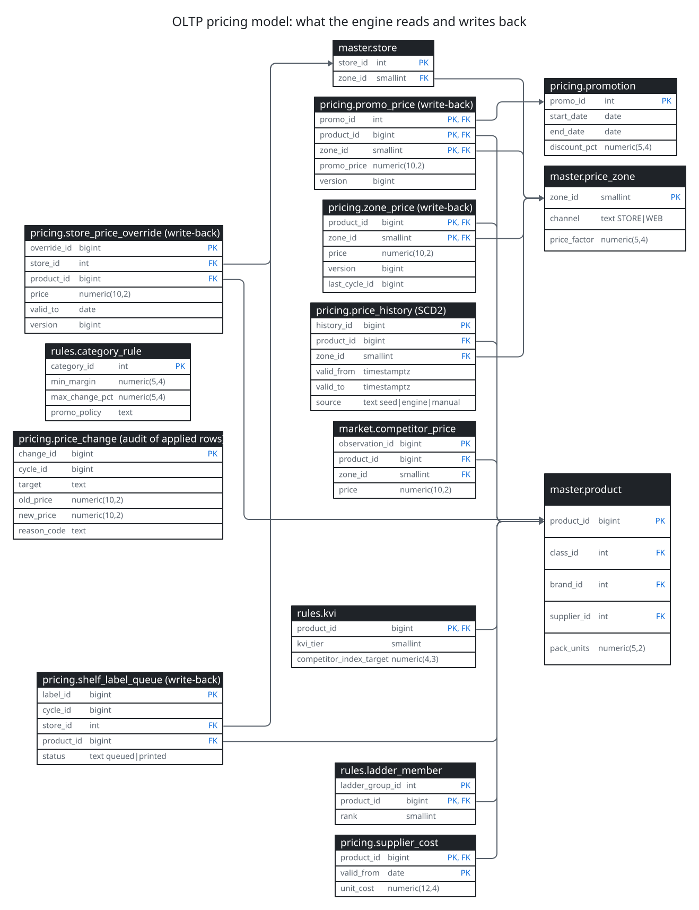
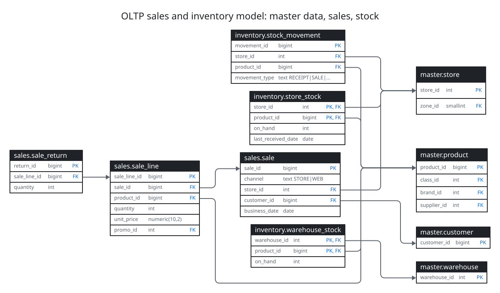
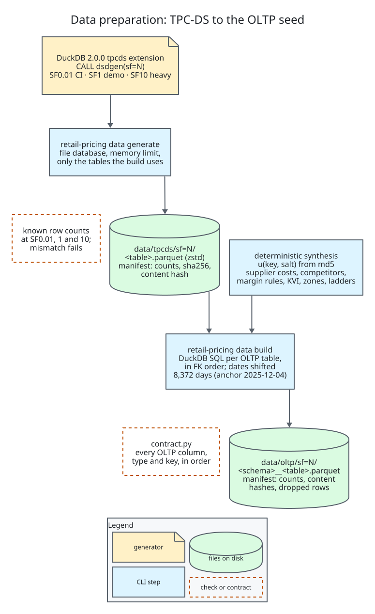

# retail-pricing-reverse-etl

> ELT plus reverse ETL for retail pricing on a laptop: a busy OLTP Postgres, Apache NiFi
> extracting it incrementally to Parquet on S3-compatible storage, ClickHouse and dbt computing new
> product prices, and NiFi writing only the changed rows back, with every job, run, step and apply
> batch audited in Postgres and the loop monitored with Prometheus and Grafana.


**Status: work in progress.** The project lands in six pull requests; `docs/PLAN.md` is the
contract and the table below says what exists today.

| Piece | State |
| --- | --- |
| TPC-DS generation and the deterministic OLTP seed | done |
| OLTP and control databases, apply functions, workload generator | done |
| ClickHouse, dbt pricing procedure, dbt runner | done |
| NiFi image, flows as code, extract and load | next |
| Transform, reverse load, reconciliation, `make demo` | planned |
| Monitoring, heavy SF10 run, results | planned |

## What this demonstrates

- Reproducible data at scale: TPC-DS generated at a chosen scale factor, mapped to a normalized
  retail OLTP model with deterministic synthetic tables (supplier costs, competitor prices, margin
  targets, KVI flags, price zones, pack-size and brand-tier ladders), with manifests of row counts
  and content hashes.
- Incremental extraction by watermark from an OLTP under load, landing Parquet in an
  S3-compatible raw zone, loaded into ClickHouse (planned).
- A multi-step pricing procedure in dbt on ClickHouse with guardrail tests and unit tests on the
  rule logic (planned).
- Reverse ETL of changed rows only, applied with optimistic concurrency (version checks),
  idempotent per cycle, with conflicts recorded and reconciliation by checksums (planned).
- Job registry and run audit in Postgres, and Prometheus plus Grafana over the whole loop
  (planned).

## OLTP and control model

The OLTP is a normalized retail schema generated from one contract (`data/contract.py`): every
row carries `version` and `updated_at`, and the three price tables the engine writes back also
carry `last_cycle_id` and `updated_by`. `pricing_apply.apply_batch` applies a staged batch in one
set-based transaction: a row changes only if its version still equals the version extracted for
the cycle, otherwise a conflict is recorded; a replayed batch returns its stored counts. The
control database registers every job and audits cycles, runs and steps through functions that
NiFi will call.



Source: [oltp-pricing-model.d2](docs/diagrams/oltp-pricing-model.d2).



Source: [oltp-sales-model.d2](docs/diagrams/oltp-sales-model.d2).

## Pricing procedure (dbt on ClickHouse)

Sixty-one dbt models turn the raw OLTP snapshot into new prices in a fixed rule order. Demand
(28/90/365-day velocity, seasonality), price elasticity per category from weekly price and
quantity, stock cover and aging, latest cost, the competitor index and KVI alignment give a
candidate price; holds, the margin floor, the change cap and the price-ending grid bound it;
pack-size and brand-tier ladders make it consistent. Store overrides, promo prices (depth kept)
and shelf labels follow from the new zone price, and the reverse diffs keep only the rows whose
hash changed, with the version extracted for each row and a batch number. Guardrail tests (cap,
margin, ladders, endings, depth, labels, batches) stop the cycle before anything is sent back,
and dbt unit tests cover the rule logic. Money is computed in integer cents.


Source: [dbt-dag.d2](docs/diagrams/dbt-dag.d2).

## Data preparation



Source: [data-prep.d2](docs/diagrams/data-prep.d2).

## Tech stack

Python 3.12 · DuckDB · PostgreSQL · Apache NiFi · ClickHouse · dbt · RustFS (S3) · Prometheus ·
Grafana · Docker Compose · GitHub Actions · uv · ruff · mypy · pytest · Hypothesis · D2

## Quickstart (today)

```bash
git clone https://github.com/emanuel-luis/retail-pricing-reverse-etl && cd retail-pricing-reverse-etl
make install
make data SF=0.01   # TPC-DS SF0.01 plus the OLTP seed under data/ (seconds)
make test           # unit tests plus the SF0.01 generation checks
make up             # OLTP and control Postgres (copies .env.example to .env when missing)
make load SF=0.01   # schema from the contract, COPY of the seed, constraints, triggers, roles
make control-init   # job registry, audit schema and functions
make test-sql       # apply/conflict/replay, triggers, roles, control functions, a workload run
make workload       # concurrent sales, stock moves and manual price edits against the OLTP
make ch-init s3-init            # ClickHouse raw tables from the contract, the raw bucket
make ch-load SF=0.01 CYCLE=1    # the seed into ClickHouse raw (NiFi does this from PR 4 on)
make dbt-build CYCLE=1          # the pricing procedure through the dbt runner container
make test-clickhouse            # raw DDL, loads, users, bucket
make down           # stop everything and delete the volumes
```

On the owner's laptop `make data SF=1` takes about 36 s and SF10 about 8.5 minutes, with DuckDB
capped at 4 GB (not TPC-DS benchmark results).

## Project structure

```
src/retail_pricing/   CLI, settings, JSON logging, data generation and build, OLTP load,
                      control init, workload generator
src/retail_pricing/sql/   duckdb/ (TPC-DS to OLTP mapping), oltp/ (triggers, apply functions,
                      roles), control/ (registry, audit, functions, views, grants)
compose.yaml          OLTP and control Postgres, ClickHouse, RustFS, dbt runner, workload
config/clickhouse/    memory, Prometheus endpoint, named collection, users and grants
dbt/                  the pricing procedure: staging, intermediate, pricing, reverse, marts
tests/                unit, SF0.01 data checks (slow), SQL tests (sql), ClickHouse tests
                      (clickhouse)
docs/                 PLAN (the contract), DECISIONS, D2 diagrams
```

## Data and licence notice

The data comes from the TPC-DS data generator (dsdgen), run locally through DuckDB's `tpcds`
extension. This repository does not redistribute dsdgen and never commits generated data. Any
timing shown here is not a TPC-DS benchmark result and is not comparable to TPC Benchmark
results. TPC, TPC-DS and TPC Benchmark are trademarks of the Transaction Processing Performance
Council.

## License

MIT, see [LICENSE](LICENSE).
