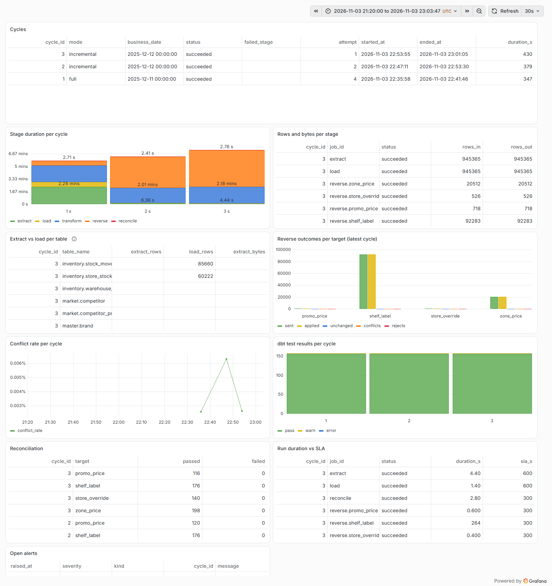
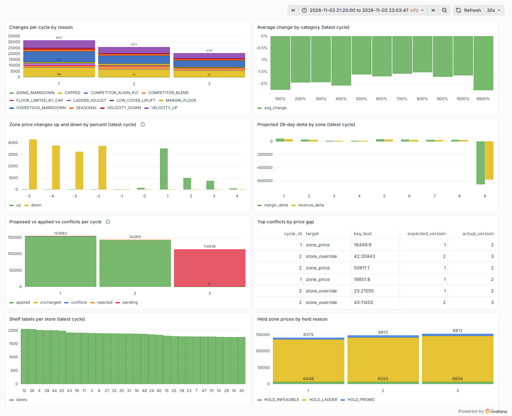
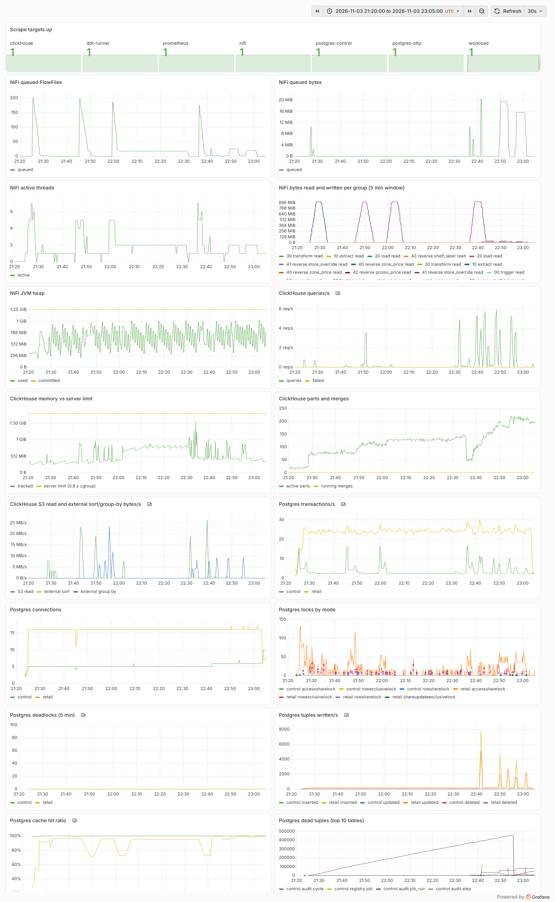

# Results

Measured runs of the loop on the owner's laptop. The data comes from the TPC-DS data generator
(dsdgen) run locally through DuckDB's `tpcds` extension. **These timings are not TPC-DS benchmark
results and are not comparable to TPC Benchmark results.** TPC, TPC-DS and TPC Benchmark are
trademarks of the Transaction Processing Performance Council.

## Machine

| | |
| --- | --- |
| CPU | AMD Ryzen 7 4800H, 8 cores, 16 threads |
| RAM | 31.4 GB, about 13 GB free when the SF10 run started |
| OS | Windows 11, Docker Desktop 29.1.3 on WSL 2 |
| Docker VM | 16 CPUs, 11.7 GiB |
| Container limits | ClickHouse 2304m, NiFi 2048m, OLTP 1280m, RustFS 1024m, others 64m to 512m |

## Summary

| | SF0.01 | SF1 | SF10 |
| --- | --- | --- | --- |
| Sale lines in the OLTP | 34,145 | | 34,051,213 |
| Rows in the OLTP seed | 45,151 | | 50,507,596 |
| OLTP load (COPY, constraints, indexes) | 4 s | | 33 min |
| Full extract (cycle 1) | 5 s | 13 to 18 s | 137 s, 50.2M rows |
| Load into ClickHouse (cycle 1) | 1 s | 1 to 4 s | 39 s |
| Incremental extract + load | 1 to 2 s | | 6 to 8 s, 0.9M to 1.6M rows |
| dbt transform per cycle | 40 s | 40 to 50 s | 121 to 131 s |
| Zone prices changed per cycle | 14 to 18 | 1,455 to 2,804 | 20,512 to 31,476 |
| Shelf labels per cycle | | | 92,283 to 120,562 |
| Conflicts per cycle | 0 to 5 | 3 | 3 to 9 |
| Reconcile | passed | passed | passed |

SF0.01 is the CI scale (`make demo SF=0.01`, cycles of 36 to 41 s on GitHub runners). The SF1
column comes from earlier `make demo` runs on the same laptop whose run folders were not kept, so
it gives ranges only and leaves out what was not recorded. The rest of this page is the SF10 run.

## SF10 run

Run folder `runs/20261103T204604Z-sf10` (git-ignored): `steps.json`, `stats.jsonl`, `timings.md`,
`timings.json`, `check.txt`. `retail-pricing check --cycles 1-3` passed all 7 checks.

### Preparation

| Step | Time |
| --- | --- |
| `data all` (TPC-DS already generated, OLTP seed build) | 203 s |
| Stack up (core and monitoring) | 69 s |
| OLTP load: COPY of 50,507,596 rows | 1,777 s (`sales.sale_line`, 34,051,213 rows, 1,346 s) |
| OLTP load: constraints, indexes, analyze | 61 s, 123 s, 10 s |
| control init, ch init (38 tables), s3 init, NiFi deploy | 2 s, 2 s, 2 s, 18 s |
| Workload start | 57 s |

A full SF10 generation without the cache adds about 190 to 203 s for dsdgen and 321 to 329 s for
the seed build.

### Stage durations (seconds)

| Stage | Cycle 1 (full) | Cycle 2 | Cycle 3 |
| --- | --- | --- | --- |
| extract | 136.8 (50,204,477 rows) | 6.4 (1,633,090) | 4.4 (945,365) |
| load | 39.2 | 1.9 | 1.4 |
| transform (dbt build, 61 models) | 130.7 | 120.6 | 130.6 |
| reverse zone_price | 15.1 | 18.7 | 25.5 |
| reverse store_override | 0.4 | 0.4 | 0.4 |
| reverse promo_price | 0.8 | 0.7 | 0.6 |
| reverse shelf_label | 21.3 | 228.0 | 263.6 |
| reconcile | 2.7 | 2.4 | 2.8 |
| Cycle total | 347 | 379 | 430 |

The slowest dbt models are `int_price_laddered` (48 to 53 s per cycle) and `int_sales_daily`
(18 to 22 s).

### Rows written back and conflicts

The workload ran through all three cycles (sales, stock moves, manual price edits).

| Cycle | Target | Sent | Applied | Unchanged | Conflicts | Rejected |
| --- | --- | --- | --- | --- | --- | --- |
| 1 | zone_price | 31,476 | 31,472 | 0 | 4 | 0 |
| 1 | store_override | 759 | 759 | 0 | 0 | 0 |
| 1 | promo_price | 1,184 | 1,184 | 0 | 0 | 0 |
| 1 | shelf_label | 120,562 | 120,548 | 0 | 0 | 14 |
| 2 | zone_price | 25,625 | 25,619 | 2 | 4 | 0 |
| 2 | store_override | 667 | 662 | 0 | 5 | 0 |
| 2 | promo_price | 927 | 927 | 0 | 0 | 0 |
| 2 | shelf_label | 115,659 | 115,607 | 0 | 0 | 52 |
| 3 | zone_price | 20,512 | 20,510 | 0 | 2 | 0 |
| 3 | store_override | 526 | 525 | 0 | 1 | 0 |
| 3 | promo_price | 718 | 718 | 0 | 0 | 0 |
| 3 | shelf_label | 92,283 | 92,242 | 0 | 0 | 41 |

A conflict is a row whose OLTP version moved after the extract (a manual edit by the workload);
it is recorded, never overwritten. Rejected labels are labels whose price row was not applied.
Reconciliation passed every check in every cycle (198 zone price, 140 to 148 store override, 116 to
126 promo price and 176 shelf label checks per cycle).

### Memory

Peak `docker stats` memory per container over the run:

| Container | Peak MiB | Limit |
| --- | --- | --- |
| clickhouse | 1,988 | 2304m |
| nifi | 1,878 | 2048m |
| oltp | 869 | 1280m |
| s3 (RustFS) | 856 | 1024m |
| workload | 256 | 256m |
| grafana | 238 | 320m |
| dbt-runner | 234 | 512m |
| prometheus | 223 | 384m |
| control-db, nifi-token, two exporters | 146 together | |

The container peaks add up to about 6.5 GiB. Seen from Windows, the Docker VM grew to about
10.5 GB during the cycles, most of it page cache from Postgres and ClickHouse files, and host free
memory was 4.3 GB at its lowest. Plan for the Docker VM to use its whole 11.7 GiB at SF10, on top
of whatever else runs on the host.

Claude Code stops its background shells when host memory runs low (it did so near 4 GB free), so
the documented run was started from a plain terminal. Two earlier attempts from Claude Code were
stopped that way during the OLTP load and the first cycle.

### What SF10 broke, and the fixes

SF0.01 and SF1 passed with the original settings. The first SF10 run failed in cycle 1, and the
fixes below were found and proven on the same running stack:

| Problem at SF10 | Fix | Evidence |
| --- | --- | --- |
| Load of `sales.sale_line` hit the 1.2 GiB ClickHouse query limit (`MEMORY_LIMIT_EXCEEDED`) | One insert pipeline (`max_insert_threads=1`), DECISIONS 143 | 1.19 GiB and a failure after 5.6M rows, against 34M rows in 37 s at 658 MiB |
| RustFS was OOM-killed at its 384m limit while ClickHouse read the files, and the load hung retrying | 1024m and `restart: unless-stopped`, DECISIONS 145 | Exit 137 with `OOMKilled`; peak 856 MiB afterwards |
| `int_sales_daily` hit the query limit: two stacked GROUP BYs over 8.5M groups | One aggregation over the union of line and return rows, two threads, DECISIONS 144 | Old shape failed even at 1.7 GB; new one 821 MiB; same rows and checksum on a 60-day window |
| `pricing_shelf_label` hit the limit: ClickHouse's greedy join reorder built hash tables on the 2.3M expanded rows | `query_plan_optimize_join_order_limit=0` in the `etl` profile, DECISIONS 146 | 1.58 GiB and a failure, against 0.6 s at 134 MiB with the same rows and checksum |

Cycle 1 ran four times (attempts 2 to 4 through `cycle trigger --rerun 1`, as the runbook
describes) and cycle 2 twice. Each rerun of a full cycle loads a full copy into the raw tables, and
the staging views read them with `FINAL`, so the raw tables were truncated before the last attempt
of cycle 1 to give it the state of a first full load. The stage durations above are from the
attempts that succeeded.

### Shelf label bottleneck

Shelf labels took 21 s in cycle 1 and 228 s and 264 s in cycles 2 and 3, while the other targets
stayed under 30 s. `pg_stat_statements` with nested statements tracked, over cycle 3:

| Statement | Calls | Total | Shared blocks |
| --- | --- | --- | --- |
| `pricing_apply.apply_batch` (all targets) | 42 | 288.7 s | 297M |
| `_apply_shelf_label` | 19 | 262.9 s | 294M |
| its first UPDATE, the reject check | 19 | 251.9 s | 291M |
| its INSERT into `shelf_label_queue` | 19 | 10.1 s | 3.6M |

The reject check touched about 15M blocks per 5,000-row batch. Run again after the cycle with the
same parameters, with a custom or a generic plan, it touches about 300,000. The stage table is filled just
before its batches are applied, and autovacuum analyzed it only after the label stage ended, so
the plans in the run were likely built on statistics that did not include the cycle's rows. The
cost grows with the stage table, which keeps every cycle's rows. A follow-up: analyze the stage
table after staging, or write the reject check so its cost does not depend on the plan.

### Dashboards

Grafana over the SF10 cycles (21:20 to 23:05 UTC), provisioned from `config/grafana/`.

Cycle 3 shows as pending in "Proposed vs applied": a cycle's marts are complete only after the
next cycle's extract. The pricing outcomes screenshot predates a label fix in the same pull request: its
"Average change by category" axis shows category ids 1 to 99 as 100% to 9900%.

## SF100 (estimate, not run)

A rough linear scaling of the SF10 numbers, not a measurement: about 340M sale lines and 500M OLTP
rows; the OLTP load alone about 5.5 hours at the SF10 COPY rate; a full extract about 23 minutes and
the raw load about 7 minutes. The pricing aggregations would hold about ten times more groups
(`int_sales_daily` about 85M), which does not fit the 1.2 GiB query limit or the 2.25 GiB ClickHouse
container; SF100 needs a larger machine than this laptop's 11.7 GiB Docker VM. Incremental cycles
scale with the workload's changes, not with the data: at SF10 they extracted 0.9M to 1.6M rows in
under 7 s.
